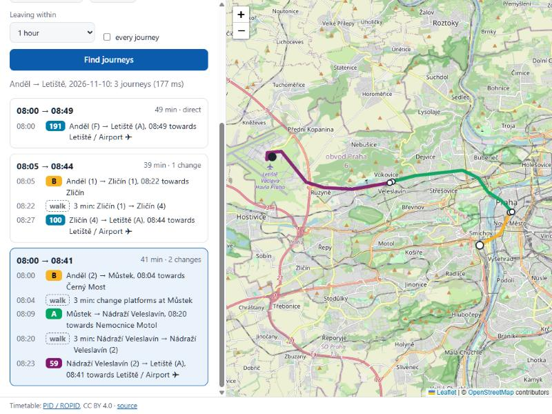

# transit-raptor

A journey planner for public transport, built on the **RAPTOR** algorithm and real timetables
in the **GTFS** format. Point it at Prague's PID timetable, name two stops, and it finds the
connections: the fastest one for each number of transfers. On the command line, or on a web
page with a map:

```
$ transit-raptor plan --gtfs data/pid --from "Anděl" --to "Letiště" --time 08:00
$ transit-raptor serve --gtfs data/pid          # http://127.0.0.1:8080/
```



## Why

Journey planners look simple from the outside and are a classic algorithms problem on the
inside. A city like Prague has thousands of stops, tens of thousands of trips a day and
millions of stop times; "how do I get from A to B" has to be answered in milliseconds. This
project implements the algorithm from the paper rather than calling an API, and runs it on a
real, openly licensed timetable.

It is a learning project: [OpenTripPlanner](https://www.opentripplanner.org/) and
[MOTIS](https://github.com/motis-project/motis) are what production systems use.

## How it works

1. **Loading** (`gtfs.ts`, `cache.ts`). A GTFS feed is a zip of CSV files. They are read once
   (`stop_times.txt` streamed line by line, `csv.ts`) into a *compiled feed*: every trip of every
   date, its stop times sorted into typed columns. A date is then cut out of it in milliseconds:
   the services from `calendar.txt` minus/plus the exceptions in `calendar_dates.txt`, plus trips
   of the *previous* day that are still running after midnight (GTFS writes those as `24:20:00`).
   Trips of that day are views into the shared columns, so a second date costs almost nothing.
   The compiled feed and the shapes are saved in a **binary cache** (typed arrays as they are in
   memory, the small tables as JSON, a CRC-32, and a fingerprint of every feed file's size and
   modification time), so the next start reads one file instead of parsing 300 MB of CSV:
   2.9 s -> 0.36 s for Prague. A changed, damaged or foreign cache file is ignored and rewritten.
2. **Timetable** (`timetable.ts`). Trips with the same stops in the same order form a
   *pattern*, sorted by departure. A trip that overtakes another (an express) gets a pattern of
   its own, because RAPTOR finds "the first trip I can still catch" with a binary search, which
   only works if trips never overtake. Walking connections come from a spatial grid (stops
   within 300 m, at 1.2 m/s with a 1.3 detour factor, at least 60 s, plus 45 s for every level
   of height difference from `levels.txt`, i.e. escalators) and from `transfers.txt`.
3. **Changes inside stations** (`stations.ts`). Where the feed has `pathways.txt`, a station is
   a directed graph: each platform's *boarding areas* (spots along the platform), corridor
   nodes and entrances, joined by walkways, stairs, escalators (often one way) and elevators.
   A change is the shortest path through it (Dijkstra with a binary heap): platform to platform,
   or out through the best entrance to a stop on the street. Getting off, the time is the
   *average* over the platform's boarding areas (one is wherever one's carriage stopped);
   getting on, the *nearest* boarding area counts. A 45 s buffer is added for getting off and
   on. These times replace the distance estimate in those stations, in both directions.
4. **RAPTOR** (`raptor.ts`), from Delling, Pajor & Werneck,
   [*Round-Based Public Transit Routing*](https://www.microsoft.com/en-us/research/?p=162045)
   (Transportation Science, 2015). Round *k* finds the earliest arrival at every stop using at
   most *k* vehicles: scan every pattern that serves a stop improved in round *k − 1* (each
   pattern once), then walk. The result is one journey per number of vehicles, kept if it
   arrives earlier than all journeys with fewer transfers: the **Pareto set** over arrival time
   and transfers. No preprocessing is needed, so a new timetable works the moment it's loaded.
   Pareto-optimal but useless journeys are dropped: anything arriving more than
   max(30 min, the fastest travel time) after the fastest journey (otherwise "direct, by the
   first night bus" shows up next to a ten-minute metro ride).
5. **rRAPTOR** (range queries, from the same paper). "Leaving at 8:00" really means "around
   8:00": RAPTOR alone takes the first vehicle that leaves, even when a later one arrives just
   as early. rRAPTOR runs RAPTOR for every departure from the origin in a window (default 60
   min), from the latest to the earliest, without resetting the labels: what a later departure
   reached stays as a bound, so an earlier one only counts where it arrives earlier, and most of
   the network is pruned. The result is a *profile*: every journey not beaten in departure,
   arrival and transfers at once. `plan` picks the fastest per number of transfers from it,
   which now also leaves as late as possible; `--list` shows the whole profile. One subtlety
   from the paper: a label may only be compared with labels of its own round, or a later
   departure with more changes would hide an earlier direct one (there is a test for that).
6. **Step-free journeys** (`--step-free`, a checkbox on the page), for wheelchairs and prams.
   A second timetable is built from the same feed: trips whose vehicle can't take a wheelchair
   (`wheelchair_accessible` 2) are left out; nobody gets on or off, or walks to, a stop marked
   as having no step-free access (`wheelchair_boarding` 2; a platform without a value takes its
   station's, as the GTFS reference says); and changes inside stations use the station graph
   without stairs and escalators, or entrances marked as not step-free. Where the only
   step-free way is out to the street and back (Muzeum A ↔ C has a lift from each platform to
   the street, nothing inside), the graph walks along the street between the station's
   entrances. Stops and trips the feed says nothing about are allowed, and the page says on
   which rides access isn't confirmed (most street stops in PID).
7. **Drawing rides along the street** (`shapes.ts`). `shapes.txt` gives every trip's line on
   the map (Prague: 7,572 shapes, 3.3 M points). The part between where one gets on and off is
   cut out by `shape_dist_traveled`, which PID gives for every stop and shape point: a binary
   search finds the segment, and both ends are interpolated. Feeds without distances get each
   stop projected onto the nearest segment, the second stop only *after* the first (a line that
   comes back past its start isn't drawn backwards). A cut end more than 150 m from its stop
   means the shape doesn't fit (a broken shape, a different unit): the ride is then drawn
   straight between its stops, and the API says which drawing it got (`shape: true/false`).
   Shapes don't depend on the date, so they are read once, in parallel with the first day's
   timetable, into typed arrays (micro-degree integers, 32-bit distances): 43 MB.
8. **Stop names** (`stops.ts`). "andel" finds every platform called "Anděl": names are compared
   without case, diacritics or punctuation; a unique prefix also works.

## On real data

Prague's PID feed of 9 Nov 2026 (valid 9-22 Nov), on a laptop with Node 26:

| | |
|---|---|
| Feed | 1.69 M stop times, 82 k trips, 20 k stops |
| Loading one day | 1.3 s (52 k trips kept), timetable 0.2 s: 6,576 patterns, 61,152 footpaths |
| Binary cache | 79 MB; a server start 2.9 s -> 0.36 s (cache read 0.11 s), a CLI query 3.3 s -> 0.64 s; a second date 1.9 s -> 0.2 s |
| Station graphs | 68 stations, 1,532 pathways, 2,922 changes, 0.1 s |
| Shapes | 7,572 shapes, 3.28 M points, 1.1 s, 43 MB kept; 52,251 of 52,273 trips of a day fit their shape |
| Memory | ~380 MB resident with two dates, shapes and the whole feed loaded (was ~760 MB before dates shared the stop-time arrays) |
| One query | 2-15 ms for one departure; 45-190 ms over a 60-minute window (rRAPTOR) |

Compared with the official planner ([IDOS for PID](https://idos.cz/pid/spojeni/)) on Tuesday
10 Nov 2026, every vehicle and arrival time below is the same to the minute:

| Journey | Both planners |
|---|---|
| Anděl -> Muzeum, 08:00 | metro B 08:00, Můstek 08:04, change ~3 min, metro A 08:09, Muzeum 08:10 |
| Anděl -> Letiště, 08:00 | bus 191 08:00-08:49; metro B + bus 100 via Zličín, 08:44 (see below); metro B + A + trolleybus 59 via Můstek and Nádraží Veleslavín, 08:41 |
| Dejvická -> Háje, 07:30 | metro A to Muzeum 07:37, change, metro C 07:41-07:58 |
| Křižíkova -> I. P. Pavlova, 17:00 | tram 24 17:02 to Florenc 17:05, metro C 17:08-17:12 |
| Náměstí Míru -> Národní třída, 17:00 | tram 22 17:01-17:10; metro A, Můstek 17:04, change ~3 min, metro B 17:08-17:09 |

The 45 s buffer is the one number not taken from the feed. The first three journeys bound it
(29-55 s, see `stations.ts`); the last two were checked afterwards, with nothing changed.

One difference is left: via Zličín, IDOS takes metro B at 08:07 and changes to bus 100 in
about 2 minutes; transit-raptor leaves at 08:05, because its estimate for that change is 3:29.
Zličín's few pathways don't reach the metro platform, so the distance estimate is used there.
(Before rRAPTOR it left at 08:00, and at 17:00 for Křižíkova instead of 17:02.)

## Stack

TypeScript 7 on Node 22+, no runtime dependencies. Vitest for tests. TypeScript because a GTFS
feed is a dozen record types whose fields are easy to mix up (a stop *index* vs a stop *id*, a
time in seconds vs a `HH:MM:SS` string); strict types catch that at compile time.

The web page is plain HTML, CSS and JavaScript (`web/`, no build step) with
[Leaflet](https://leafletjs.com/) 1.9.4 from cdnjs (pinned, with subresource integrity) and
OpenStreetMap tiles. The server is `node:http` (`src/server.ts`): three routes don't need a
framework.

## Install and run

Needs Node 22.12 or newer.

```bash
git clone https://github.com/Gallileee/transit-raptor.git
cd transit-raptor
npm install
npm run build

npm run fetch-pid          # downloads Prague's timetable (~50 MB) into data/pid
node dist/bin.js plan --gtfs data/pid --from "Anděl" --to "Muzeum" --time 8:00
node dist/bin.js plan --gtfs data/pid --from "Anděl" --to "Muzeum" --date 2026-11-14 --max-transfers 1
node dist/bin.js plan --gtfs data/pid --from "Anděl" --to "Letiště" --time 8:00 --list   # the next hour
node dist/bin.js plan --gtfs data/pid --from "Hlavní nádraží" --to "Křižíkova" --step-free
node dist/bin.js stops --gtfs data/pid --search "nadrazi"
```

`--date` and `--time` default to now. `--window MIN` (default 60) is how far after `--time`
departures are considered; `--window 0` leaves as early as possible. `--list` prints every
journey worth taking in the window instead of the best per number of transfers.
`--step-free` keeps to step-free vehicles, stops and changes. The first run on a feed writes
a binary cache into `DIR/.transit-raptor-cache/` (about 80 MB for Prague; `--cache DIR` puts it
elsewhere, `--no-cache` reads the CSV files and writes nothing); later runs start in well under a
second and rebuild it by themselves when the feed is downloaded again. Any other
unzipped GTFS feed works too: pass its folder as `--gtfs`. Example output on the test feed:

```
Alpha -> Delta, Náměstí, 2026-11-10

08:05 -> 08:30  (25 min, direct)
  08:05–08:30  bus 300 towards Delta, Náměstí: Alpha -> Delta, Náměstí (2 stops)

08:00 -> 08:15  (15 min, 1 transfer)
  08:00–08:05  tram 1 towards Charlie: Alpha -> Bravo (1) (1 stop)
  08:05–08:06  walk 1 min: Bravo (1) -> Bravo (2)
  08:08–08:15  bus 200 towards Delta, Náměstí: Bravo (2) -> Delta, Náměstí (1 stop)
```

Exit codes: `0` journeys found, `1` no journey, `2` bad input or feed.

### The web page

```bash
node dist/bin.js serve --gtfs data/pid [--port 8080] [--host 127.0.0.1]
```

It loads today's timetable and the shapes at start (about 2.7 s), keeps the two most recently used dates in
memory (one day of Prague is ~360 MB), and serves:

- `/`: a form (stop names suggested as you type), the journeys, and the selected journey on a
  map, every leg in its line's colour from `routes.txt`, walks dashed. The search is kept in
  the URL, so a result can be shared or bookmarked.
- `GET /api/plan?from=&to=[&date=YYYY-MM-DD][&time=HH:MM][&window=MIN][&maxTransfers=N][&list=1][&stepFree=1]`:
  the journeys as JSON, with names, times, line colours, the line to draw (`path`: along the
  street from `shapes.txt` when `shape` is true, otherwise straight between the stops passed)
  and, per ride, `access`: `yes` (vehicle and both stops marked step-free), `no`
  or `unknown`. The step-free timetable of a date is built on its first use (~0.4 s) and kept.
- `GET /api/stops?q=TEXT[&date=]`: stop names for the suggestions.

Bad input gets `400` with a message, and for an unknown or ambiguous stop a list of names to
pick from; a feed that can't be loaded gets `503`. The server listens on 127.0.0.1 unless told
otherwise, serves a fixed list of three files (no URL path reaches the file system), and sends a
Content-Security-Policy that only allows cdnjs and the map tiles. The page writes everything it
shows with `textContent`, and only uses a line colour if it is six hex digits.

## Tests

```bash
npm test             # vitest
npm run typecheck    # tsc --noEmit, strict
```

The tests run on a hand-made feed (`tests/fixtures/mini`) in which every part exists to test one
thing: a transfer with a walk between platforms, an express that overtakes a slower bus, a stop
where the line doesn't pick up, a night bus past midnight (seen from the next day too), a public
holiday from `calendar_dates.txt`, a walk that only `transfers.txt` allows, a stop with no times,
quoted names with commas and a byte order mark, and for step-free journeys a station with lifts
(one marked as not step-free) and vehicles and stops with and without access, and three
shapes (with distances, without, and one that lies elsewhere). `cache.test.ts` checks that
every date cut from the cache equals the date read from CSV, and that a stale, damaged,
cut-off or unwritable cache only means reading the CSV again. `server.test.ts` runs the HTTP server on a free
port and calls it like a browser would (JSON shapes, errors, headers, paths outside the three
files). CI runs them on Node 22 and 24, runs the built CLI, and checks its own workflow with
[workflow-guard](https://github.com/Gallileee/workflow-guard).

The page itself was checked by hand in a browser (desktop and phone width, light and dark): the
three journeys to the airport, line colours on the map, suggestions for an ambiguous stop.

## Limitations

- rRAPTOR runs RAPTOR once per departure in the window; for a busy stop and a long window that
  is hundreds of runs (still well under a second for Prague, but not for a whole day).
- Outside the 68 stations with pathways, walking is straight-line distance times a detour
  factor plus a penalty per level, not a street network. Those values are cautious on purpose:
  a too-short change suggests a connection that fails in reality.
- Inside stations, walkways have no lengths or times in PID's feed, so their time is the
  straight line between their ends at 1.2 m/s. Signposted exits aren't used yet.
- Step-free mode trusts the feed: unknown stops and trips are allowed (PID marks most street
  stops as unknown), `transfers.txt` times are used as they are, and walks between stops
  outside the stations with pathways assume the street is passable. Compared with IDOS's
  barrier-free search on 16 Nov: same journey Hlavní nádraží -> Palmovka; at Muzeum A -> C it
  allows 8 min for the change (via the street) where IDOS allows about 3.
- Footpaths aren't chained (one walk between two vehicles), as in the paper.
- No real-time delays, fares, or daylight-saving corrections (GTFS times are
  measured from "noon minus 12 h", which differs from midnight on the two DST days).
- Stops without times in `stop_times.txt` take the previous stop's departure instead of an
  interpolated time.
- The cache trusts file sizes and modification times: a feed file edited in place within the
  same millisecond and to the same size would not be noticed (`--no-cache` or deleting the
  folder helps). It is written for little-endian machines only (all common ones); elsewhere it
  is just not written.
- The web server is meant for one user on their own machine: no authentication, no rate
  limiting, one process. Map tiles come straight from tile.openstreetmap.org, which is fine for
  that but not for a public site (OSM's tile usage policy).
- The page has no automated browser tests; the API under it does.
- Walks are drawn as straight lines; only rides follow the street.
- Shapes are matched to stops by distance or by nearest segment, not by map matching: a shape
  that wanders more than 150 m from a stop is not used at all (22 trips of a day in PID, where
  the shape really ends kilometres before the last stop).

## Data

The Prague timetable is published by PID / ROPID at
[pid.cz/o-systemu/opendata](https://pid.cz/o-systemu/opendata/) under
[CC BY 4.0](https://creativecommons.org/licenses/by/4.0/) (credit: PID / ROPID). It is
downloaded by `npm run fetch-pid` and never committed to this repository.

## Next steps

See [PROGRESS.md](PROGRESS.md).

## License

MIT for the code.
